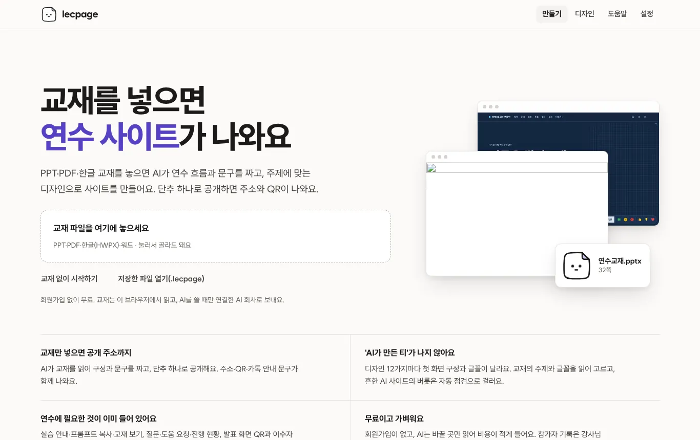
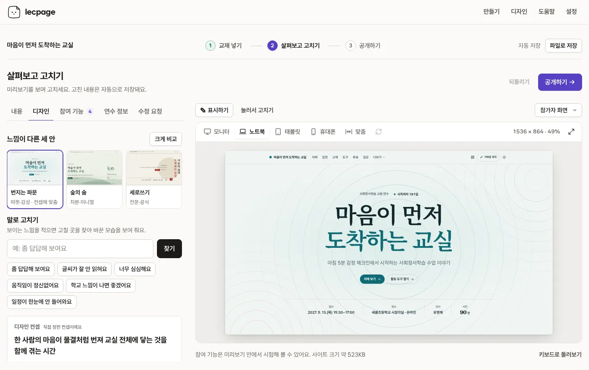
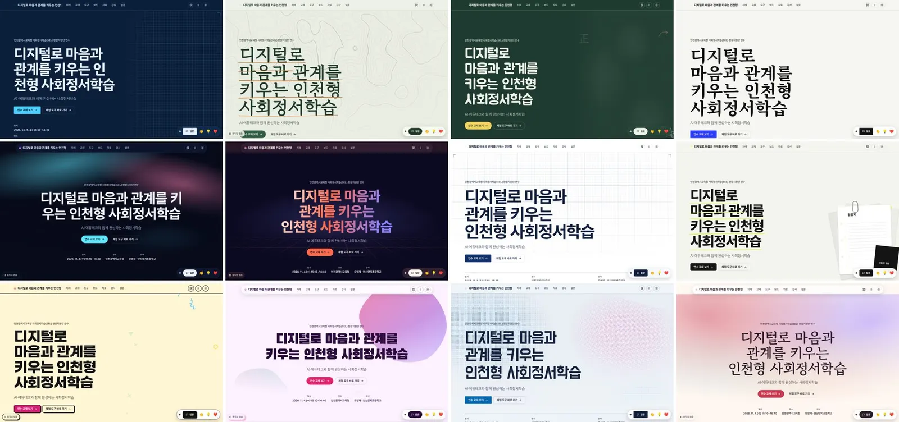
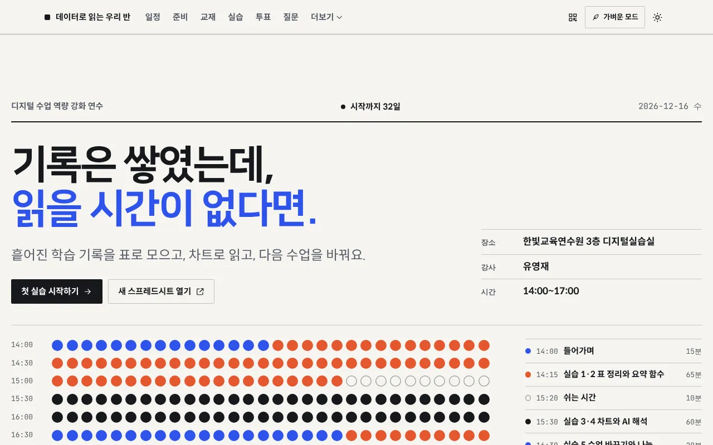
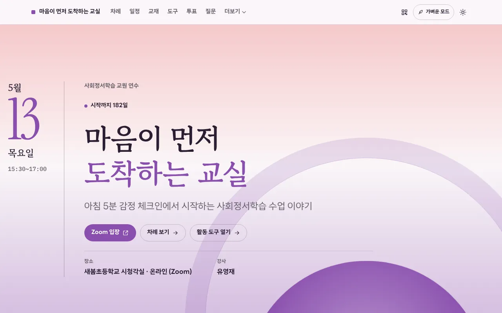

<p align="center"></p>

# lecpage

**교재를 넣으면 연수 사이트가 나와요.** 연수 교재(PPT·PDF·한글 HWPX·워드)를 놓으면 AI가 연수 흐름과 문구를 짜고, 주제에 맞는 디자인으로 사이트를 만들어요. 단추 하나로 공개하면 참가자에게 보낼 주소와 QR이 나와요. 무료·오픈소스이고 회원가입이 없어요.

- **웹앱**: 브라우저에서 바로 → **https://yoorrard.github.io/lecpage/**
- **Agent Skill**: Claude Code·Codex·Cursor·Gemini CLI 등 쓰던 AI 도구 안에서, 쓰던 구독 그대로

```bash
npx skills add yoorrard/lecpage
```

<p align="center"> </p>
<p align="center"></p>
<p align="center"> </p>

## AI에게 그냥 시킬 때와 무엇이 다른가요

| | 그냥 시키면 | lecpage |
|---|---|---|
| 디자인 | 비슷한 틀이 반복되고 검증이 없음 | 연수 주제에서 컨셉(참가자가 겪는 경험 한 줄과 모티프)을 먼저 세우고 그에 맞는 디자인을 고름. 디자인 27종마다 첫 화면 구성·글 배치·글꼴·섹션 문법이 다름(그림이 이끄는 첫 화면 8종, 가운데·세로쓰기·어긋난 격자·반반 화면 같은 색다른 배치 포함). 정적인 페이지부터 스크롤 연출까지 고르고, 본문도 섹션 종류마다 구조가 다른 배치(목표 다섯 가지·일정 다섯 가지 등, 교재 값으로 그린 도식과 모티프 그림 포함)를 디자인마다 다르게 조합하며 섹션마다 다르게 등장함. 대비·줄바꿈·넘침·'AI 티'를 자동 점검 |
| 내용 | 그럴듯하게 지어낼 수 있음 | 교재 쪽을 근거로 구성하고 "교재 n쪽"으로 표시. 스키마 검증·자동 보정 |
| 기능 | 정적 페이지 한 장 | 교재 보기·실습·프롬프트 복사·질문·투표·나눔 보드·강사 화면·발표 화면·QR 안내문·접속 확인 |
| AI 비용 | HTML 전체를 쓰고, 고칠 때마다 다시 씀 | 설계도(JSON)와 작은 패치만. 같은 일에 읽는 글 약 1/12, 쓰는 글 약 1/170([조사](docs/research/skill-efficiency-2026-11.md)) |
| 공개 | 받은 파일을 직접 올림 | 올릴 곳을 추천하고 단추 하나로 공개, 주소가 열리는지까지 확인 |
| 안전 | 직접 챙김 | CSP·이스케이프·암호 보호(AES-GCM), 개인정보 안내 자동 생성 |

## 세 단계면 끝나요

| 단계 | 하는 일 |
|---|---|
| ① 교재 넣기 | 파일을 놓으면 연수명·날짜·장소를 찾아 채워요. 바라는 점은 '요청 사항'에 한두 줄 적어요. [AI로 사이트 만들기]를 누르면 기본 초안이 먼저 나오고, 1~2분 뒤 AI가 짠 내용으로 바뀌어요(되돌리기 가능). AI는 키를 한 번 연결해요: ChatGPT(OpenAI)나 Claude의 키를 붙여 넣어요. 돈을 들이지 않고 해 보려면 Gemini 무료 키도 돼요(결과가 단순할 수 있어요). 쓸 모델을 고를 수 있고, 추천은 그때의 가격·출시일로 매긴 고품질 등급의 최신 모델이에요. 무료 한도에 걸리면 앱이 기다렸다 다시 하거나 같은 등급의 다른 모델로 이어가고, 유료 연결로 넘어가기 전에는 물어봐요([설정]에서 '멈추기 / 유료로 이어가기'). AI 없는 기본 초안도 있어요. |
| ② 살펴보고 고치기 | 미리보기를 모니터·노트북·태블릿·휴대폰 크기로 바꿔 보며 내용·디자인·참여 기능을 고쳐요. **고칠 곳을 펜·네모로 표시해 AI에게 보내면** 고칠 안을 받아 한 번에 적용해요. |
| ③ 공개하기 | 누가 볼지(주소를 받은 사람만·암호·누구나) 고르고 [공개하기]. 주소·QR·카톡 안내 문구가 나오고, 주소가 실제로 열리는지 확인해 줘요. 한 번 연결한 곳은 다음부터 단추 하나예요. |

## 무엇을 만들어 주나요

| | |
|---|---|
| 사이트 유형 4가지 | 강의형(특강) · 실습형(워크숍) · 행사형(설명회·컨퍼런스) · 과정형(여러 차시 직무연수) |
| 섹션 30종 | 첫 화면, 연수 목표·대상, 핵심 메시지, 오늘의 차례, 일정(지금 순서 강조), 준비 점검+접속 확인, 교재 보기, 실습(단계·프롬프트 복사·완료 체크·메모), 도구 모음, 질문 받기, 나눔 보드, 투표·워드클라우드, 퀴즈, 자료실, 강사 소개, 사이트 안 만족도 설문, 마무리, 연수 뒤 안내 등. 온라인 연수는 Zoom 입장 단추가 맨 앞에 |
| 강사용 화면 | 강사 화면(진행 현황·도움 요청·질문 관리·공지·타이머·강사 따라 넘기기·이수자 명단 CSV·일괄 삭제), 발표 화면(큰 QR·질문·투표 결과·이름 뽑기·모둠·타이머), QR 안내문 인쇄, 접속 확인 |
| 자료 올리기 | 자료실에 내 컴퓨터의 파일을 올리면 참가자가 내려받아요. 공개한 뒤에 더 넣고 [바뀐 내용 다시 올리기]를 누르면 같은 주소에 반영돼요. 연수 중에는 강사 화면에서 자료 링크를 바로 추가해요. 참가자의 결과물은 나눔 보드(글·사진·파일)로 받아요 |
| 공개 범위 | 기본은 검색 제외(주소를 받은 사람만). **암호 보호**는 페이지와 교재 그림까지 브라우저에서 암호화하고, 안내 QR로 들어오면 바로 열려요. 교재 원본은 고를 때만 올려요 |
| 참여 기능 연결 | 강사 계정에 직접: 구글 시트(50명 안팎) · Supabase(100명 안팎) · Cloudflare(큰 행사) · 학교 서버·NAS(Docker) · 인터넷 없는 교실(강사 노트북). lecpage 운영자는 참가자 기록을 보지 않아요 |
| 공개하는 곳 | 앱에서 바로: **Vercel**(토큰 한 번, 다시 올려도 같은 주소) · GitHub Pages · Netlify. 운영자가 [바로 공개 서버](hosting/README.md)를 켜 두면 가입 없이 공개하고 참여 기능까지 함께 켜져요. ZIP으로: Cloudflare(끌어 놓기)·학교 서버·USB. 사이트 크기·인원·연결해 둔 곳을 보고 멈출 걱정이 적은 곳을 먼저 권하고, 고른 곳마다 무료 한도를 넘으면 어떻게 되는지 한 줄로 알려요. 운영비 구조는 [운영비와 멈추지 않기 점검](docs/research/zero-cost-2026-11.md). [안내서 15가지](skills/lecpage/references/deploy) |

## 디자인

정하는 순서는 **디자인(분위기) → 디자인 토큰 → 첫 화면 구성과 섹션 배치 → 페이지 연출(정적·차분하게·보통·스크롤 연출) → 자리별 효과 → 대표 효과 하나**예요. 연수 주제·분위기·교재 글꼴로 디자인을 고르고, 기관 색과 교재의 대표 색으로 토큰을 맞춰요. '스크롤 연출'을 고르면 스크롤에 맞춰 첫 화면이 물러나고 다음 장면이 덮이며, 차례가 쌓이고 일정 선이 그려져요(저사양 기기·동작 줄이기에서는 완성된 정지 모습). 눈에 띄는 효과는 연수마다 하나만 두고 실습·질문·교재 화면은 늘 차분해요. 앱의 [디자인 둘러보기](https://yoorrard.github.io/lecpage/#/gallery)에서 디자인과 52가지 효과가 실제로 움직이는 것을 볼 수 있어요. 근거: [디자인 조사 2026-11](docs/research/design-trends-2026-11.md).

<!-- design:start -->
| 디자인 | 첫 화면 | 글꼴(제목 · 본문 · 숫자) |
|---|---|---|
| 밤하늘 서사 `night-story` | 영화 첫 장면: 큰 제목과 아래 요약 띠 | 페이퍼로지 · 아스타 산스 · Bricolage Grotesque |
| 종이 워크북 `paper-workbook` | 오늘의 실습지 카드 | 프리젠테이션 · Pretendard · Barlow Condensed |
| 유리 실험실 `glass-lab` | 벤토 요약(일시·장소·실습·교재) | 에이투지체 · Wanted Sans · Space Grotesk |
| 놀이터 `playground` | 포스터: 기울인 제목 상자와 도구 띠 | 케리스 케듀체 · SUIT · Bricolage Grotesque |
| 숲의 숨 `calm-forest` | 여백 많은 명조 구성 | 마루 부리 · 나눔휴먼 · Fraunces |
| 공식 브리핑 `official-brief` | 공문 머리띠와 정보 표, 숫자 | 나눔스퀘어 네오 · Pretendard GOV · IBM Plex Sans Condensed |
| 잉크 잡지 `editorial-ink` | 잡지 제호와 두 단 리드 | 함렛 · Noto Serif KR · Fraunces |
| 도파민 팝 `retro-pop` | 스티커와 큰 글자 | 베이글 팻 원 · 페이퍼로지 · Unbounded |
| 칠판 교실 `chalkboard` | 칠판과 오늘의 차례 | 학교안심 둥근미소 · 나눔스퀘어라운드 · Caveat |
| 설계도 `blueprint-tech` | 설계 도면: 모눈과 치수선 | IBM Plex Sans KR · IBM Plex Mono |
| 형광 인쇄 `riso-zine` | 망점 인쇄물 | 가석 · 고딕 A1 · Anton |
| 새벽빛 `sunrise-warm` | 초대장: 큰 날짜와 명조 제목 | 고운바탕 · LINE Seed Sans KR · Instrument Serif |
| 어두운 키노트 `keynote-dark` | 키노트: 검은 무대와 아주 큰 제목 | Wanted Sans · Geist |
| 깔끔한 기업형 `corporate-clean` | 오늘의 일정 카드 | SUIT · Sora |
| 부드러운 파스텔 `soft-pastel` | 부드러운 도형과 날짜 | 나눔스퀘어라운드 · LINE Seed Sans KR · Outfit |
| 움직이는 글자 `kinetic-type` | 아주 큰 글자와 메아리 띠 | 페이퍼로지 · 스포카 한 산스 네오 · Big Shoulders Display |
| 따뜻한 미니멀 `warm-minimal` | 큰 날짜 숫자와 정보 표 | 나눔명조 · 아스타 산스 · Fraunces |
| 펼친 교재 `deck-collage` | 교재 쪽을 부채처럼 펼친 3D 더미 | 페이퍼로지 · 아스타 산스 · Sora |
| 하루 시계 `time-dial` | 하루 일정을 그린 둥근 시계 | 아스타 산스 · Red Hat Display |
| 입체 궤도 `knot-orbit` | 점으로 짠 입체 매듭과 둘레를 도는 낱말 | G마켓 산스 · Noto Sans KR(본고딕) · Syne |
| 돌과 물결 `stone-stream` | 연수 제목으로 그린 돌과 물결 그림 | 송명 · 고딕 A1 · Instrument Serif |

마지막 4가지(펼친 교재·하루 시계·입체 궤도·돌과 물결)는 첫 화면에 그림이 들어 있어요. 그림은 정지 모습으로 먼저 그려지고, 마우스에 반응하며 움직여요. 움직임을 줄인 기기와 가벼운 모드에서는 정지 그림 그대로 보여요.

색 조합 34 × 글꼴 58종(짝 25) × 효과 58가지를 자리 18곳에 골라 써요. 글꼴은 한글 제목·한글 본문·숫자와 영문용 라틴 제목·고정폭 네 벌로 짜요. **교재의 글꼴을 읽어 같은 글꼴(없으면 어울리는 무료 웹 글꼴)로** 만들어요.

| 종류 | 효과(영문 이름) |
|---|---|
| 글자 11 | 글자 드러내기(Split reveal) · 움직이는 글자 굵기(Kinetic weight) · 스크롤 글 차오름(Scroll fill) · 왼쪽부터 또렷해지는 글자(Decode reveal) · 흐르는 그라데이션 글자(Gradient text) · 흐르는 띠(Marquee) · 숫자 올라가기(Count up) · 자모 타자(Hangul typewriter) · 형광펜 긋기(Highlight sweep) · 낱말 바꾸기(Word rotate) · 밑줄 차오름 링크(Link underline) |
| 스크롤 10 | 조용한 떠오르기(Reveal up) · 마스크 사진 열기(Clip reveal) · 은은한 시차(Soft parallax) · 선 그리기·일정 레일(Line draw) · 진행 막대·단계 표시(Guided progress) · 그림 고정 스크롤(Sticky scrollytelling) · 쌓이는 카드(Stacking cards) · 가로 넘김(Horizontal snap) · 톤 여정(밤→새벽→낮)(Tone journey) · 사진 확대 통과(Zoom through) |
| 반응 9 | 자석 버튼(Magnetic button) · 3D 기울기 카드(Tilt card) · 포인터 조명(Spotlight) · 따라오는 커서 고리(Cursor follower) · 복사 버튼 반응(Copy feedback) · 완료 축하(Confetti) · 누름 물결(Ripple) · 화면 전환 잇기(View transition) · 테두리 빛줄기(Border beam) |
| 배경·질감 23 | 오로라(Aurora) · 메시 그라데이션(Mesh gradient) · 필름 그레인(Grain) · 원근 바닥 격자(Perspective grid) · 별밤(Starfield) · 연결 점망(Particle network) · 물결 점 격자(Dot grid) · 등고선 지형(Topographic lines) · 겹 물결(Waves) · 숨 쉬는 덩어리(Morphing blobs) · 빛망울(Bokeh) · 활동지 묶음(Paper stack) · 손그림 낙서·주석(Doodles & annotations) · 도형 무늬(Memphis shapes) · 칠판(Chalkboard) · 흐르는 색(Shader gradient) · 빛나는 구(Glowing orb) · 인쇄 망점(Risograph) · 설계도 모눈(Blueprint grid) · 펼친 교재(Slide fan) · 하루 시계(Schedule dial) · 입체 궤도(Orbit knot) · 돌과 물결(Stone & stream) |
| 라이브러리 3 | 부드러운 휠 스크롤(Smooth scroll (Lenis)) · 고정 장면 스크롤(GSAP ScrollTrigger scrub) · 점 구슬(Point-cloud sphere (OGL)) |
<!-- design:end -->

| 쓰는 기술 | |
|---|---|
| 레이아웃 | CSS Grid(벤토·비대칭 격자), `position: sticky`(고정 그림·쌓이는 카드), `scroll-snap`(가로 넘김), 컨테이너 쿼리 |
| 움직임 | 스크롤 구동 애니메이션(`animation-timeline: view()`), IntersectionObserver, View Transitions API, `@property`, SVG 선 그리기, 가변 글꼴 굵기 |
| 그래픽 | Canvas 2D, WebGL(OGL), `clip-path`·`mask`, `backdrop-filter`, `mix-blend-mode`. 바깥 라이브러리는 셋(GSAP ScrollTrigger·Lenis·OGL)뿐이고, 학교망에서 막히면 그 효과만 저절로 빠져요 |
| 색·토큰 | OKLCH 12단계 색 램프, 밝게·어둡게 WCAG AA 자동 검사, DTCG 2025.10 형식 `tokens.json`, 사이트마다 `DESIGN.md` |
| 배려 | 기기의 '동작 줄이기'와 사이트의 **가벼운 모드**를 따름. 실습·질문·교재 화면은 늘 차분하게. 사양이 낮은 기기는 한 단계 낮춰 재생 |

'AI 티'를 막는 [디자인 규칙](skills/lecpage/references/design-quality.md)(알약 칩·겹친 상자·보라 그라데이션·세 칸 카드·옆 색띠 금지 등)과 자동 점검(`design-lint`)이 빌드마다 돌아요.

## Skill로 쓰면

AI가 HTML을 직접 쓰지 않고, 정해진 엔진과 짧은 명령으로 만들어요.

| 명령 | 하는 일 |
|---|---|
| `make 교재.pptx 교재.pdf` | 교재 해석 → 초안 → 검증 → 빌드 → 점검을 한 번에 |
| `brief` · `patch` | 짧은 요약을 읽고, 바꿀 곳만 작은 패치로 고치기 |
| `options` | 디자인 3안을 그림 한 장으로 비교 |
| `review dist` | 강사가 사이트에 펜·네모로 표시한 수정 요청을 파일로 받기 |
| `infra` | 인원·기능·네트워크로 참여 기능 연결 방식과 올릴 곳 고르기 |
| `qa` · `doctor` | 휴대폰·태블릿·PC × 밝게·어둡게 점검(디자인·문구 검사 포함) · 환경 점검 |

## 저장소 구조
```
skills/lecpage/        Agent Skill (자체 완결: SKILL.md, references, engine, scripts, backends, templates, examples)
  engine/src/          설계도 검증·결정 규칙·디자인 토큰·렌더러·교재 해석·AI 프롬프트 (브라우저+Node 공용)
  engine/runtime/      생성 사이트에 들어가는 실행 파일(효과 fx/, 실시간 live/, 강사 화면·발표 화면)
  backends/            supabase · apps-script · cloudflare · node-server
app/                   웹앱 (Vite + Preact, 정적 배포)
hosting/               바로 공개 서버(선택, Cloudflare Worker + Durable Objects): 가입 없는 공개와 참여 기능
docs/                  기획서, 아키텍처 계약, 운영 결정, 약관, 조사 자료
```

## 개발
```bash
npm test                       # 엔진 테스트
npm run examples               # 예시 사이트 2개 빌드(.out/)
npm --prefix app install
npm run app:dev                # 웹앱 개발 서버
node skills/lecpage/scripts/lecpage.mjs build skills/lecpage/examples/sel-story.blueprint.json -o dist
node skills/lecpage/scripts/lecpage.mjs qa dist
```

## 문서
- [기획서](docs/plan.md) · [아키텍처와 계약](docs/architecture.md) · [웹앱 운영 안내(운영자용)](docs/operations.md) · [보안 정책](SECURITY.md)
- [이용약관](docs/legal/terms.md) · [개인정보 처리방침](docs/legal/privacy.md) · [참가자 개인정보 안내 가이드(강사용)](docs/legal/participant-privacy-guide.md)
- 조사: [디자인 흐름 2026-11](docs/research/design-trends-2026-11.md) · [호스팅 재조사 2026-11](docs/research/hosting-2026-11.md) · [글꼴](docs/research/fonts-2026-11.md) · [미리보기·반응형](docs/research/preview-responsive-2026-11.md) · [2026-11 점검 결정 기록](docs/research/2026-11-review.md) · [사이트 구성](docs/research/site-content-2026-11.md) · [AI 연결](docs/research/ai-connection-2026-11.md) · [수정 요청](docs/research/review-chat-2026-11.md) · [Skill 효율](docs/research/skill-efficiency-2026-11.md) · [앱 운영 방식](docs/research/app-operations.md) · [모션·그래픽](docs/research/motion-graphics.md) · [참여 플랫폼](docs/research/platforms.md)

## 라이선스
| 무엇 | 라이선스 | 뜻 |
|---|---|---|
| 엔진·Skill·웹앱(기본) | **Apache-2.0** | 누구나 쓰고 고치고 배포할 수 있어요. 특허 사용 허락이 명시돼 있고, 이름·로고 권리는 넘기지 않아요 |
| 만든 사이트에 복사되는 실행 파일(`engine/runtime`), 실시간 서버(`backends`), 배포 설정 파일(`templates`) | **MIT-0** | 출처 표시 의무도 없어요. 만든 연수 사이트에 라이선스 문구를 넣지 않아도 돼요 |
| lecpage로 만든 사이트·문서 | 만든 사람의 것 | lecpage 라이선스와 무관해요 |
| 이름 "lecpage"와 마스코트 로고 | 상표 정책 | [TRADEMARKS.md](TRADEMARKS.md) |

함께 쓰는 라이브러리·글꼴은 [THIRD_PARTY_NOTICES.md](THIRD_PARTY_NOTICES.md)를, 앱에 묶인 라이브러리의 라이선스 전문은 앱의 `licenses.txt`를 보세요.

© 2026 lecpage 기여자
