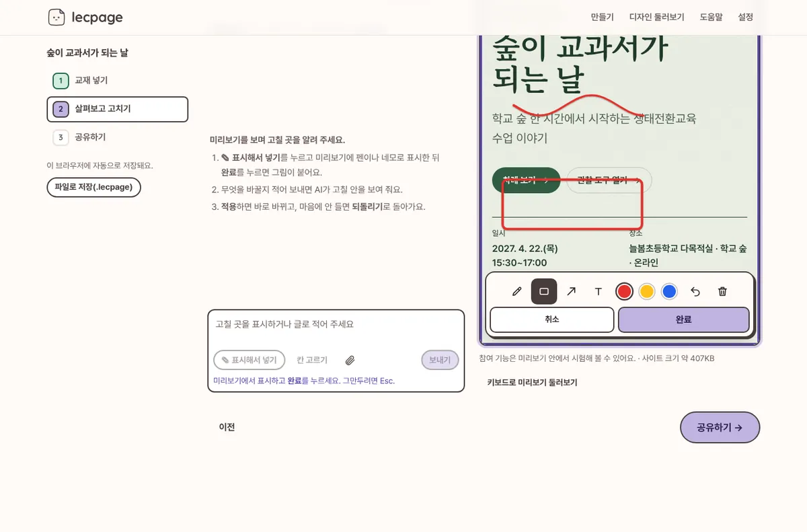
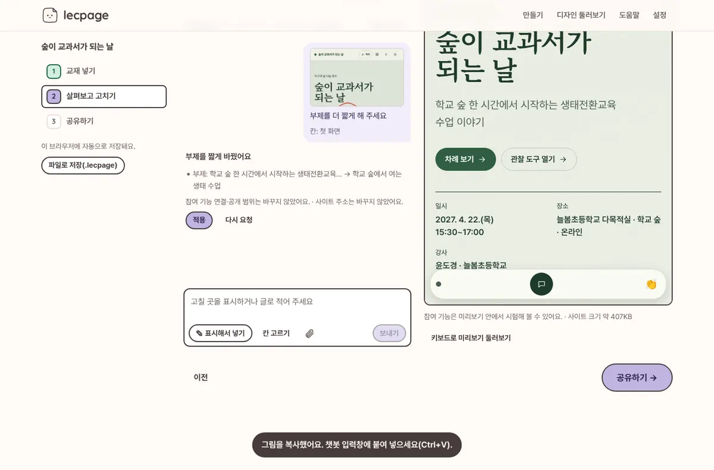
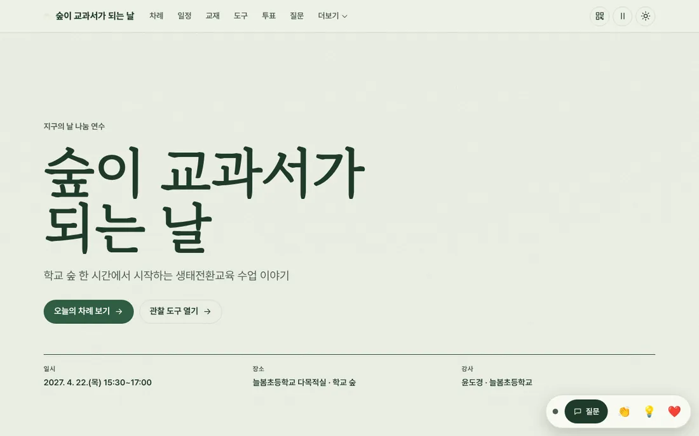

<p align="center"></p>

# lecpage

**교재를 넣으면 연수 사이트가 나와요.** 연수 교재(PPT·PDF·한글 HWPX·워드)를 놓으면, 그 연수에 맞는 디자인·실습 안내·교재 넘겨 보기·참여 기능(질문·막혔어요·진행 체크·투표·만족도 설문)을 갖춘 연수 사이트가 바로 나와요. 무료·오픈소스이고, 회원가입이 없어요.

- **웹앱**: 브라우저에서 바로. 교재는 브라우저 안에서만 읽어요. → **https://yoorrard.github.io/lecpage/** (Cloudflare·자기 도메인으로 옮길 준비: [운영 안내](docs/operations.md))
- **Agent Skill**: Claude Code·Codex·Cursor·Gemini CLI·Antigravity 등 내가 쓰는 AI 도구 안에서, 쓰던 구독 그대로.

```bash
npx skills add yoorrard/lecpage
```

<p align="center"> </p>
<p align="center"> </p>
<p align="center"></p>
<p align="center"> </p>

## 세 단계면 끝나요
| 단계 | 하는 일 |
|---|---|
| ① 교재 넣기 | 파일을 놓으면 연수명·날짜·장소를 찾아 미리 채우고, [사이트 만들기]를 누르면 초안이 바로 나와요(AI 없이도). |
| ② 살펴보고 고치기 | 미리보기를 보며 내용·디자인·참여 기능을 고쳐요. 칸을 눌러 바로 고치고, **고칠 곳을 펜·네모로 표시해 AI에게 보내면** 고칠 안을 받아 한 번에 적용(되돌리기 가능). |
| ③ 공유하기 | 누가 볼지(주소를 받은 사람만·암호·누구나) 고르고, 참여 기능을 연결하고(구글 시트 10분, 연결 확인 단추), 주소·QR·카톡 안내 문구를 받아요. |

## 무엇을 만들어 주나요
| | |
|---|---|
| 사이트 유형 4가지 | 이야기형(특강) · 실습형(워크숍) · 라이브형(설명회·컨퍼런스) · 과정형(여러 차시 직무연수) |
| 칸(섹션) 30종 | 첫 화면, 연수 목표·대상, 핵심 메시지, 오늘의 차례, 일정(지금 순서 강조), 준비 점검+접속 진단, 교재 넘겨 보기, 실습 정거장(단계·프롬프트 복사·완료 체크·메모), 도구 모음, 질문, 참여 보드, 투표·낱말 구름, 퀴즈, 자료실, 강사 소개, **사이트 안 만족도 설문**, 마무리, **연수 뒤 안내**(녹화·자료·이수 일정, 날짜가 지나면 저절로 앞으로) 등. 온라인 연수는 Zoom 입장 단추가 맨 앞에 |
| 강사용 화면 | 강사 화면(진행 현황·막힌 사람·질문 관리·공지·타이머·따라가기·**이수 확인표 CSV**·일괄 삭제), 발표 화면(큰 QR·질문·투표 결과·이름 뽑기·모둠·타이머), QR 안내문 인쇄, 와이파이 점검 |
| 공개 범위 | 기본은 검색 제외(주소를 받은 사람만). **암호 보호**는 페이지와 교재 그림까지 브라우저에서 암호화(AES-GCM)하고, 안내 QR로 들어오면 저절로 열려요. 교재 원본은 고를 때만 올려요 |
| 디자인 | 분위기 디자인 12종 × 색 조합 34 × 글꼴 짝 25 × 효과 52가지. **교재 글꼴을 읽어 같은 글꼴(없으면 어울리는 무료 웹 글꼴)로** 만들어요. 알약 칩·겹친 상자·옆 색띠 같은 'AI 티'를 막는 [디자인 규칙](skills/lecpage/references/design-quality.md)과 자동 점검(design-lint) |
| 참여 기능 연결 | 강사 계정에 직접: 구글 시트(50명 안팎, 앱 안 안내) · Supabase · Cloudflare(단추 하나) · 학교 서버·NAS(Docker) · 인터넷 없는 교실(강사 노트북). lecpage 운영자는 참가자 기록을 보지 않아요 |
| AI 연결(선택) | AI 없이도 초안이 나와요. 다듬을 때는 쓰는 챗봇에 붙여넣기(무료) 또는 한 번 연결(OpenRouter 로그인·Gemini 키). 키 앞글자로 회사 자동 인식, 연결 확인, 단계별 발급 안내 |
| 올리기 | Netlify(연결 코드 한 번, 다시 올려도 같은 주소) · GitHub Pages · ZIP(Cloudflare·Netlify 끌어 놓기, 학교 서버, USB). 안내서 15가지 |

## Skill로 쓰면
AI가 HTML을 직접 쓰지 않고, 정해진 엔진과 짧은 명령으로 만듭니다. 같은 교재로 사이트를 만들고 두 번 고칠 때 AI가 읽는 글은 약 1/12, 쓰는 글은 약 1/170로 줄었어요([조사](docs/research/skill-efficiency-2026-11.md)).

| 명령 | 하는 일 |
|---|---|
| `make 교재.pptx 교재.pdf` | 교재 해석 → 초안 → 검증 → 빌드 → 점검을 한 번에 |
| `brief` · `patch` | 짧은 요약을 읽고, 바꿀 곳만 작은 패치로 고치기 |
| `options` | 디자인 3안을 그림 한 장으로 비교 |
| `review dist` | 강사가 사이트에 펜·네모로 표시한 수정 요청을 파일로 받기 |
| `qa` · `doctor` | 휴대폰·PC × 밝게·어둡게 점검(디자인·문구 검사 포함) · 환경 점검 |

## 저장소 구조
```
skills/lecpage/        Agent Skill (자체 완결: SKILL.md, references, engine, scripts, backends, templates, examples)
  engine/src/          설계도 검증·결정 규칙·디자인 토큰·렌더러·교재 해석·AI 프롬프트 (브라우저+Node 공용)
  engine/runtime/      생성 사이트에 들어가는 런타임(효과 fx/, 실시간 live/, 콘솔·프로젝터)
  backends/            supabase · apps-script · cloudflare · node-server
app/                   웹앱 (Vite + Preact, 정적 배포)
docs/                  기획서, 아키텍처 계약, 운영 결정, 조사 자료
```

## 개발
```bash
npm test                       # 엔진 테스트
npm run examples               # 견본 사이트 2개 빌드(.out/)
npm --prefix app install
npm run app:dev                # 웹앱 개발 서버
node skills/lecpage/scripts/lecpage.mjs build skills/lecpage/examples/forest-story.blueprint.json -o dist
node skills/lecpage/scripts/lecpage.mjs qa dist
```

## 문서
- [기획서](docs/plan.md) · [아키텍처와 계약](docs/architecture.md) · [웹앱 운영 안내(운영자용)](docs/operations.md) · [보안 정책](SECURITY.md)
- 조사: [2026-11 점검 결정 기록](docs/research/2026-11-review.md) · [사이트 구성](docs/research/site-content-2026-11.md) · [AI 연결](docs/research/ai-connection-2026-11.md) · [수정 요청](docs/research/review-chat-2026-11.md) · [Skill 효율](docs/research/skill-efficiency-2026-11.md) · [앱 운영 방식](docs/research/app-operations.md) · [호스팅](docs/research/hosting.md) · [모션·그래픽](docs/research/motion-graphics.md) · [참여 플랫폼](docs/research/platforms.md)

## 라이선스
| 무엇 | 라이선스 | 뜻 |
|---|---|---|
| 엔진·Skill·웹앱(기본) | **Apache-2.0** | 누구나 쓰고 고치고 배포할 수 있어요. 특허 사용 허락이 명시돼 있고, 이름·로고 권리는 넘기지 않아요 |
| 만든 사이트에 복사되는 실행 파일(`engine/runtime`), 실시간 서버(`backends`), 배포 견본(`templates`) | **MIT-0** | 출처 표시 의무도 없어요. 만든 연수 사이트에 라이선스 문구를 넣지 않아도 돼요 |
| lecpage로 만든 사이트·문서 | 만든 사람의 것 | lecpage 라이선스와 무관해요 |
| 이름 "lecpage"와 마스코트 로고 | 상표 정책 | [TRADEMARKS.md](TRADEMARKS.md) |

함께 쓰는 라이브러리·글꼴은 [THIRD_PARTY_NOTICES.md](THIRD_PARTY_NOTICES.md)를 보세요.
