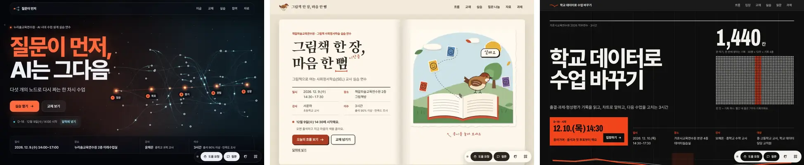

<p align="center"></p>

<h1 align="center">lecpage</h1>

<p align="center"><b>교재를 넣으면 연수 사이트가 나와요.</b><br>
바쁜 강사님의 시간과 토큰을 아껴드립니다</p>

<p align="center">강의·연수를 하는 강사와 연수 담당자가 쓰는 무료 오픈소스 도구예요. 회원가입이 없어요.</p>

<p align="center"><a href="https://lecpage.com/"><b>웹앱 열기</b></a> · <a href="https://lecpage.com/#/demo">먼저 해보기</a> · <a href="#ai-에이전트에서-쓰기">AI 에이전트에서 쓰기</a></p>

<p align="center"> </p>

| | |
|---|---|
| **무엇** | PPT·PDF·한글(HWP·HWPX)·워드 교재로, 참가자가 강의 당일 휴대폰에 열어 두고 쓰는 그 강의의 사이트를 만들어요. 교재 넘기기·출석·질문·투표·퀴즈·나눔 보드·실습 단계, 강사 화면·발표 화면, 바로 배포와 QR 안내문까지 들어 있어요 |
| **누가** | 강의·연수·워크숍을 하는 강사와 연수 담당자(학교·기업·공공기관·학원 등) |
| **어떻게** | 고른 AI(ChatGPT·Claude 구독 계정, 쓰던 AI, API 키, AI 에이전트)가 교재 원본을 직접 읽고 강의 진행용 사이트 전체를 만들어요. 참고용 디자인 라이브러리는 선택이고, lecpage는 강의 엔진으로 참여 기능·강사 화면·발표 화면·배포를 맡아요 |

## 누구나 만들 수 있지만, 잘 만들어 나누려면 노하우가 필요합니다

lecpage는 그 노하우를 세 가지로 담아 AI에게 함께 건네요.

| | 하는 일 |
|---|---|
| **요청 설계** | 목적을 '강의를 운영하는 사이트'로 정하고, 참가자가 당일 하는 일(지금 순서·출석·교재 보기·실습 원문·질문과 투표)과 디자인 기준을 담아 교재 원본과 한 번에 건네요. 교재에 있는 사실은 원문 그대로 옮기게 해요 |
| **디자인 라이브러리** | 결 16가지, 한글 글꼴 짝, 움직임 기법(WebGL·SVG 애니메이션·스크롤 연출), 강의 사이트 구성법, 'AI 티' 점검표([design-library.md](skills/lecpage/references/design-library.md)). 템플릿 같지 않은 이 강의만의 디자인을 끌어내요 |
| **강의 엔진** | 교재 넘기기·출석·질문·투표·퀴즈·나눔 보드·실습 단계·프롬프트 복사·자료실·만족도 조사를 사이트에 끼우고, 강사 화면·발표 화면·QR 안내문·접속 확인 쪽을 함께 만들어요 |

<p align="center"></p>

참고 디자인 셋은 모두 AI가 교재 원본을 읽고 Skill 흐름 그대로 만든 강의 사이트예요([references/designs](skills/lecpage/references/designs)). 앱의 [참고 디자인](https://lecpage.com/#/gallery)에서 참가자·강사·발표 화면과 QR 안내문까지 열어 볼 수 있어요.

| 사례 | 교재 | 디자인 |
|---|---|---|
| 질문이 먼저, AI는 그다음 | 16:9 어두운 슬라이드 17쪽 | WebGL 신경망 첫 화면, 접혀 오르는 제목, 유리 띠, 접히는 프롬프트 콘솔 |
| 그림책 한 장, 마음 한 뼘 | A4 가로 그림책 16쪽 | 찢은 종이 콜라주, 3D로 넘기는 실습 책, 직접 그린 참새 캐릭터 |
| 학교 데이터로 수업 바꾸기 | 16:9 스위스 격자 16쪽 | 아주 큰 좁은 숫자, 기록 1,440칸, 만지며 바꾸는 차트 |

강의 당일에는 세 화면이 함께 움직여요.

| 화면 | 하는 일 |
|---|---|
| 발표 화면 | 교재 쪽을 크게 띄우고 강사 화면과 함께 넘겨요. 출석 QR·투표 결과·타이머·공지를 그 위에 띄워요 |
| 강사 화면 | 출석 명단을 실시간으로 보고 고치고 CSV로 받아요. 퀴즈 정답 띄우기, 실습 타이머, 발표 화면 원격 조정 |
| 참가자 휴대폰 | 교재를 강사 따라 넘기며 출석·질문·투표·퀴즈·나눔 보드에 참여하고, 실습 프롬프트를 바로 복사해요 |

인터넷 배포 없이 노트북 한 대로 강의실 Wi-Fi에서 참여 기능을 열 수도 있어요.

## 시작하기

**웹앱**: **https://lecpage.com/** 에 교재 파일을 놓으면 시작해요. 쪽 그림·미리보기는 브라우저에서 하고, 교재 원본은 고른 AI로만 가요(lecpage 서버는 거치지 않아요).

1. **교재 넣기**: 교재 파일을 놓고, 바라는 점을 한 줄 적어요(선택).
2. **AI 선택**: 추천 순서는 셋이에요.
   - **ChatGPT·Claude 구독으로 연결(API 키 없이)**: [ChatGPT·Claude 계정으로 연결] → **lecpage 커넥트**를 한 번 받아 켜요(Windows는 [`lecpage-connect.cmd`](https://github.com/yoorrard/lecpage/releases/download/studio-latest/lecpage-connect.cmd)를 내려받아 두 번 누르고, macOS·Linux는 화면에 보이는 한 줄을 터미널에 붙여 넣어요: `curl -fsSL https://github.com/yoorrard/lecpage/releases/download/studio-latest/lecpage-connect.sh | bash`) → lecpage.com이 다시 열리며 이 PC와 저절로 연결 → [ChatGPT 계정으로 로그인]이나 [Claude 계정으로 로그인]. 처음 연결할 때는 안내를 확인하고 체크한 뒤 [연결]을 눌러요. 로그인하면 바로 만들기 시작하고, 사용량은 그 계정의 요금제에서 차감돼요. ChatGPT는 [Sign in with ChatGPT](https://developers.openai.com/siwc)(Plus·Pro, Codex 설치 없이)로 PC에서 OpenAI를 바로 부르고, Claude는 PC에 설치한 Claude Code를 써요(설치·로그인 버튼이 화면에 있어요). 로그인 정보는 이 PC에만 있고, 요청은 이 PC에서 AI 회사로 바로 가요. 자세히: [references/studio.md](skills/lecpage/references/studio.md)
   - **설치 없이: 쓰던 AI로**: 프롬프트를 복사해 쓰던 ChatGPT·Claude 앱에 붙여 넣고 교재를 첨부해요. 답을 복사해 돌아와 붙여 넣어요. 무료 요금제도 돼요.
   - **다른 방법**(접혀 있어요): Claude·GPT API 키(쓴 만큼 AI 회사에 직접 내요), Codex, AI 에이전트(Skill).
3. **만들기·수정**: 교재 원본과 요청을 한 번에 보내면 AI가 사이트 전체를 만들어요. AI가 교재 원본을 직접 읽고 강의 진행 사이트를 만들어요. 교재 내용은 교재 넘기기와 강사의 강의로 전하고, 사이트에는 핵심 한두 줄만 담아요. 첫 쪽은 짧게, 긴 실습은 따로 쪽을 나눠 담을 수 있어요. lecpage는 참여 기능을 끼우고 휴대폰·PC 화면을 그려 넘치거나 낱말이 갈리는 곳을 알려 줘요. 미리보기에서 글자를 눌러 바로 고치거나 AI에게 수정을 요청해요(바뀐 파일만 받아요).
4. **배포하기**: 가입 없이 바로 배포하거나 내 계정으로 배포해요(Vercel·Netlify는 첫 배포 때 계정의 기본 보호 설정을 자동으로 풀어 참가자가 바로 열어요. ZIP은 바로 내려받아요). 사이트를 지우거나 기간이 끝나면 예전 주소는 모두 안내 쪽으로 바뀌어요. 배포 전에 예시 주소·지난 날짜 같은 것을 알려 주고, 주소·QR 안내문·카톡 안내 문구가 나와요. 연수 당일에는 강사 화면에서 발표 화면을 프로젝터에 띄워 교재 쪽을 함께 넘기고, 출석 명단을 고쳐요.

화면별 안내는 앱의 [도움말](https://lecpage.com/#/help/start)에 있어요.

### AI 에이전트에서 쓰기

웹앱에서 만들 때 가장 쉬운 길은 위의 구독으로 연결(lecpage 커넥트)예요. 대화창에서 바로 만들고 싶으면 쓰던 AI 에이전트(Claude Code·Codex 등)에 lecpage 스킬을 넣어요. 에이전트가 교재 원본을 직접 읽고 스킬의 요청 설계·디자인 라이브러리·레퍼런스로 사이트를 쓰고, lecpage는 쪽 그림 준비, 강의 기능(질문·투표·출석·실습 단계 등), 화면 살펴보기·배포를 맡아요. 쓰던 구독 그대로 쓰고, 만든 연수는 `.lecpage` 파일로 웹앱에서 열어 고치고 배포해요. 인터넷 배포 없이 노트북 한 대로 교실 와이파이 참여까지 하려면 스킬의 `serve work --live`를 써요([SKILL.md](skills/lecpage/SKILL.md)).

| 도구 | 설치(한 줄) |
|---|---|
| Claude Code | 대화창에 `/plugin install lecpage --marketplace yoorrard/lecpage`(터미널은 `claude plugin install lecpage --marketplace yoorrard/lecpage`) |
| Codex | `$skill-installer https://github.com/yoorrard/lecpage/tree/main/skills/lecpage` |
| Cursor 등 그 밖의 도구 | `npx skills add yoorrard/lecpage`(모든 프로젝트에 쓰려면 `-g`) |
| claude.ai | `skills/lecpage` 폴더를 ZIP으로 묶어 설정 → 기능 → 스킬 올리기 |

Claude Code는 2.1.30 이상을 권해요(스킬은 2.0.20부터, PDF를 쪽 범위로 읽기는 2.1.30부터). `claude --version`으로 확인하고 `claude update`로 올려요.

그다음 "이 PPT로 연수 사이트 만들어 줘"라고 말해요. 명령과 흐름은 [SKILL.md](skills/lecpage/SKILL.md)에 있어요. 설치 근거: [Claude Code 플러그인](https://code.claude.com/docs/en/plugins/install) · [Codex 스킬](https://developers.openai.com/codex/skills) · [skills CLI](https://github.com/vercel-labs/skills)

## 드는 돈

| | |
|---|---|
| lecpage | **0원**. 회원가입이 없어요 |
| AI | ChatGPT·Claude 구독으로 연결하면 그 요금제 사용량에서, 쓰던 AI 앱이면 **추가 비용 없음**. API 키를 쓰면 쓴 만큼 그 AI 회사에 직접 내요 |
| 배포·참여 기능 | 바로 배포는 가입 없이 **0원**. 내 계정(Vercel·GitHub Pages·Netlify·Cloudflare·구글 시트 등)에도 배포할 수 있어요 |

## 더 알아보기

- 무엇을 만들어 주나요: [기획서](docs/plan.md)(사이트 유형·섹션·강사용 화면) · [디자인 라이브러리](skills/lecpage/references/design-library.md) · [레퍼런스 사이트](skills/lecpage/references/designs) · 앱의 [참고 디자인](https://lecpage.com/#/gallery)
- 배포와 참여 기능: [배포할 곳 안내서](skills/lecpage/references/deploy) · [참여 기능 연결 고르기](skills/lecpage/references/infra-decision.md) · [운영비와 멈추지 않기](docs/research/zero-cost-2026-11.md)
- 개발자용: [아키텍처와 계약](docs/architecture.md) · [문구 기준](docs/writing.md) · [동작 기준](docs/interaction.md) · [웹앱 운영 안내](docs/operations.md) · [바로 배포 서버](hosting/README.md) · [조사 기록](docs/research)
- 약속: [보안 정책](SECURITY.md) · [이용약관](docs/legal/terms.md) · [개인정보 처리방침](docs/legal/privacy.md) · [참가자 개인정보 안내 가이드(강사용)](docs/legal/participant-privacy-guide.md)

## 개발

```bash
npm test                     # 엔진 테스트
npm run examples             # 레퍼런스 사이트 조립·검수(.out/)
npm --prefix app install
npm run app:dev              # 웹앱 개발 서버
```

```
skills/lecpage/   Agent Skill(자체 완결): SKILL.md · references(키트 설명서·디자인 원칙·레퍼런스) · engine(키트 조립·검수·교재 읽기·보조 화면) · backends · scripts
app/              웹앱(Vite + Preact, 정적 배포). 같은 엔진을 씀
hosting/          바로 배포 서버(선택, Cloudflare Worker)
docs/             기획서·아키텍처·운영·약관·조사 기록
```

## 라이선스

| 무엇 | 라이선스 | 뜻 |
|---|---|---|
| 엔진·Skill·웹앱(기본) | **Apache-2.0** | 쓰고 고치고 배포할 수 있어요. 특허 사용 허락이 명시돼 있고, 이름·로고 권리는 넘기지 않아요 |
| 만든 사이트에 복사되는 실행 파일(`engine/runtime`), 실시간 서버(`backends`), 배포 설정 파일(`templates`) | **MIT-0** | 출처 표시 의무도 없어요. 만든 연수 사이트에 라이선스 문구를 넣지 않아도 돼요 |
| lecpage로 만든 사이트·문서 | 만든 사람의 것 | lecpage 라이선스와 상관없어요 |
| 이름 "lecpage"와 마스코트 로고 | 상표 정책 | [TRADEMARKS.md](TRADEMARKS.md) |

함께 쓰는 라이브러리·글꼴은 [THIRD_PARTY_NOTICES.md](THIRD_PARTY_NOTICES.md)에, 앱에 묶인 라이브러리의 라이선스 전문은 앱의 `licenses.txt`에 있어요.

만든 사람: 유영재([yoorrard](https://github.com/yoorrard)) · © 2026 lecpage 기여자
