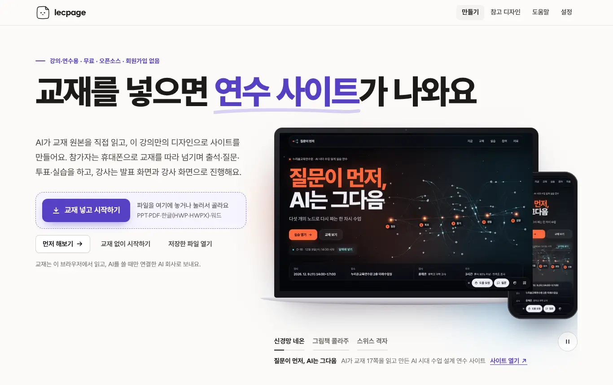
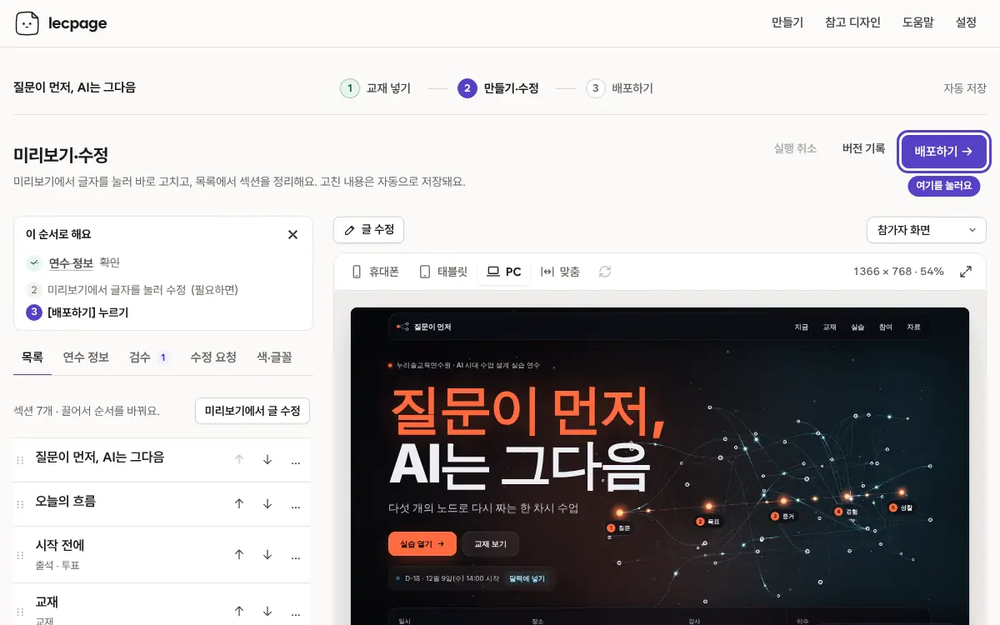
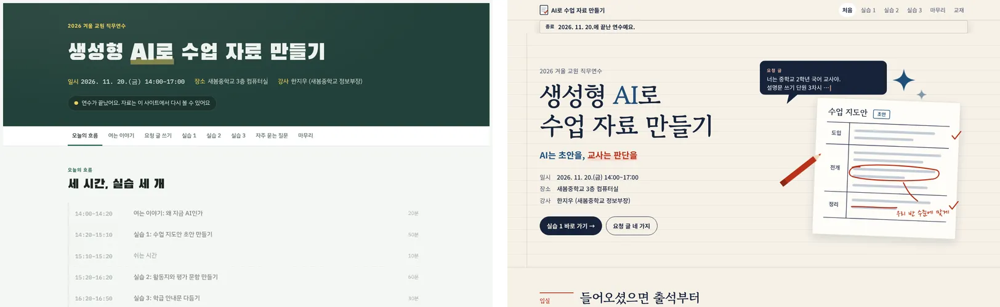

<p align="center"></p>

<h1 align="center">lecpage</h1>

<p align="center"><b>교재를 넣으면 연수 사이트가 나와요.</b><br>
바쁜 강사님의 시간과 토큰을 아껴드립니다</p>

<p align="center">강의·연수를 하는 강사와 연수 담당자가 쓰는 무료 오픈소스 도구예요. 회원가입이 없어요.</p>

<p align="center"><a href="https://lecpage.com/"><b>웹앱 열기</b></a> · <a href="https://lecpage.com/#/demo">먼저 해보기</a> · <a href="#ai-에이전트에서-쓰기">AI 에이전트에서 쓰기</a></p>

<p align="center"> </p>

| | |
|---|---|
| **무엇** | PPT·PDF·한글(HWP·HWPX)·워드 교재로 참가자가 곁에 두고 쓰는 그 연수의 사이트를 만들어요. 질문·투표·퀴즈·출석·도움 요청, 강사 화면·발표 화면, 바로 배포와 QR 안내문까지 들어 있어요 |
| **누가** | 강의·연수·워크숍을 하는 강사와 연수 담당자(학교·기업·공공기관·학원 등) |
| **어떻게** | 고른 AI(내 PC의 Claude Code·Codex, Claude·GPT API 키, 쓰던 AI)가 교재 원본과 짧은 요청 하나로 사이트 전체를 만들어요. lecpage는 디자인과 구성에 끼어들지 않고, 강의 기능·배포·진행을 맡아요. AI가 교재 원본을 직접 읽고 사실은 원문 그대로 옮겨요 |

## 누구나 만들 수 있지만, 잘 만들어 나누려면 노하우가 필요합니다

AI 에이전트에 맡겨도 사이트는 나와요. lecpage는 같은 AI의 디자인을 그대로 살리고, 그냥 맡길 때는 없는 강의 기능·배포·QR·강사 화면·발표 화면을 더해요. AI가 교재 원본을 직접 읽고 사실은 원문 그대로 옮겨요.

<p align="center"></p>

같은 교재(30쪽 PDF, 가상의 교원 연수)를 같은 AI(Claude)에게 한 번씩 맡겨 견줬어요(2026-11-21 · [재는 방법](docs/research/benchmark-2026-11.md#compare)).

| | AI 에이전트에 그냥 맡길 때 | lecpage(내 PC 연결) |
|---|---|---|
| 첫 화면 | 정보를 늘어놓은 페이지 | 주제를 그린 삽화(빨간 펜으로 고친 지도안·손글씨 메모·공책 줄) |
| 휴대폰에서 낱말 갈림 | 4곳 | 0곳 |
| 교재 사실 25개 | 25개 맞음 | 25개 맞음, 복사할 요청 글 7개도 원문 그대로 |
| 참여 기능 | 없음 | 질문·출석·도움 요청 등 |
| 배포·QR | 강사가 직접 | 앱에서 바로 |
| 만든 시간 | 약 3분 | 약 12분(키로 연결하면 약 8분) |

만든 다음에도 단계마다 강사가 할 일이 달라요.

| 단계 | AI 에이전트에 그냥 맡길 때 | lecpage |
|---|---|---|
| 화면 살펴보기 | 휴대폰에서 낱말이 갈리거나 넘치는 곳은 강사가 열어 봐야 알아요 | 휴대폰·PC 화면을 그려 보고 알려 줘요. 알림은 참고용이고, 고칠지는 강사가 정해요 |
| 배포 | ZIP 압축 풀기·배포할 곳에 로그인·폴더 끌어 놓기·사이트 이름 바꾸기·QR 페이지 열기·주소 확인을 강사가 해요 | 앱이 해요. 가입 없이 바로 배포할 수도 있어요 |
| 질문·투표 준비 | 투표 서비스에 가입해 행사·문항을 만들고 링크를 넣어 다시 배포해요. 참가자는 사이트 밖에서 투표해요 | 질문·투표·퀴즈·출석이 사이트 안에 있어요 |
| 연수 당일·연수 후 | 교재 화면과 사이트를 번갈아 띄워요. 명단은 설문을 새로 만들어 받아요 | 발표 화면이 교재 쪽을 크게 띄우고 강사 화면과 함께 넘겨요. 출석 명단은 강사 화면에서 고치고 CSV로 받아요 |

배포·질문·투표 준비로 강사가 할 일은 그냥 맡길 때 12가지, lecpage는 0가지예요(같은 기기 두 번째 연수부터, 2026-11-13 · [재는 방법](docs/research/benchmark-2026-11.md#setup)).

## 시작하기

**웹앱**: **https://lecpage.com/** 에 교재 파일을 놓으면 시작해요. 쪽 그림·미리보기는 브라우저에서 하고, 교재 원본은 고른 AI로만 가요(lecpage 서버는 거치지 않아요).

1. **교재 넣기**: 교재 파일을 놓고, 바라는 점을 한 줄 적어요(선택).
2. **AI 고르기**: 추천 순서는 셋이에요.
   - **내 PC의 Claude Code·Codex**: 쓰던 구독 그대로 써요. Node.js가 있는 PC에서 `npx -y github:yoorrard/lecpage studio`로 연결 프로그램을 켜요.
   - **Claude·GPT API 키**: 키를 넣으면 앱이 교재를 AI에 바로 보내요. 쓴 만큼 AI 회사에 직접 내요.
   - **쓰던 AI**: 요청 글을 복사해 쓰던 ChatGPT·Claude 앱에 붙여 넣고 교재를 첨부해요. 답을 복사해 돌아와 넣어요.
3. **만드는 중 → 살펴보고 고치기**: 교재 원본과 짧은 요청 하나를 한 번에 보내면 AI가 사이트 전체를 만들어요. AI가 교재 원본을 직접 읽고 사실은 원문 그대로 옮겨요. lecpage는 참여 기능을 끼우고, 화면 살펴보기 결과를 참고로 보여 줘요. 고칠지는 강사가 정하고, 미리보기에서 글자를 눌러 바로 고치거나 AI에게 수정을 요청해요.
4. **배포하기**: 가입 없이 바로 배포하거나 내 계정으로 배포해요. 배포 전에 예시 주소·지난 날짜 같은 것을 알려 주고, 주소·QR 안내문·카톡 안내 문구가 나와요. 연수 당일에는 강사 화면에서 발표 화면을 프로젝터에 띄워 교재 쪽을 함께 넘기고, 출석 명단을 고쳐요.

화면별 안내는 앱의 [도움말](https://lecpage.com/#/help/start)에 있어요.

### AI 에이전트에서 쓰기

웹앱에서 만들 때 가장 쉬운 길은 위의 내 PC 연결 프로그램(`npx -y github:yoorrard/lecpage studio`)이에요. 대화창에서 바로 만들고 싶으면 쓰던 AI 에이전트(Claude Code·Codex 등)에 lecpage 스킬을 넣어요. 에이전트가 교재 원본을 직접 읽고 디자인과 구성을 정해 사이트를 쓰고, lecpage는 쪽 그림 준비, 강의 기능(질문·투표·출석·실습 단계 등), 화면 살펴보기·배포를 받쳐요. 쓰던 구독 그대로 쓰고, 만든 연수는 `.lecpage` 파일로 웹앱에서 열어 고치고 배포해요. 인터넷 배포 없이 노트북 한 대로 교실 와이파이 참여까지 하려면 스킬의 `serve work --live`를 써요([SKILL.md](skills/lecpage/SKILL.md)).

| 도구 | 설치(한 줄) |
|---|---|
| Claude Code | 대화창에 `/plugin install lecpage --marketplace yoorrard/lecpage`(터미널은 `claude plugin install lecpage --marketplace yoorrard/lecpage`) |
| Codex | `$skill-installer https://github.com/yoorrard/lecpage/tree/main/skills/lecpage` |
| Cursor 등 그 밖의 도구 | `npx skills add yoorrard/lecpage`(모든 프로젝트에 쓰려면 `-g`) |
| claude.ai | `skills/lecpage` 폴더를 ZIP으로 묶어 설정 → 기능 → 스킬 올리기 |

Claude Code는 2.1.30 이상을 권해요(스킬은 2.0.20부터, PDF를 쪽 범위로 읽기는 2.1.30부터). `claude --version`으로 확인하고 `claude update`로 올려요.

그다음 "이 PPT로 연수 사이트 만들어 줘"라고 말해요. 명령과 흐름은 [SKILL.md](skills/lecpage/SKILL.md)에 있어요. 설치 근거: [Claude Code 플러그인](https://code.claude.com/docs/en/plugins/install) · [Codex 스킬](https://developers.openai.com/codex/skills) · [skills CLI](https://github.com/vercel-labs/skills)

## 드는 돈

| | |
|---|---|
| lecpage | **0원**. 회원가입이 없어요 |
| AI | 내 PC의 Claude Code·Codex는 쓰던 구독 그대로, 쓰던 AI 앱이면 **추가 비용 없음**. API 키를 쓰면 쓴 만큼 그 AI 회사에 직접 내요 |
| 배포·참여 기능 | 바로 배포는 가입 없이 **0원**(마지막 배포 뒤 60일 보관). 내 계정(Vercel·GitHub Pages·Netlify·Cloudflare·구글 시트 등)에 배포하면 그 계정의 무료 한도 안에서 돌아가요 |

## 더 알아보기

- 무엇을 만들어 주나요: [기획서](docs/plan.md)(사이트 유형·섹션·강사용 화면) · [강의 사이트 디자인 원칙](skills/lecpage/references/design-principles.md) · 앱의 [디자인 둘러보기](https://lecpage.com/#/gallery)
- 배포와 참여 기능: [배포할 곳 안내서](skills/lecpage/references/deploy) · [참여 기능 연결 고르기](skills/lecpage/references/infra-decision.md) · [운영비와 멈추지 않기](docs/research/zero-cost-2026-11.md)
- 개발자용: [아키텍처와 계약](docs/architecture.md) · [문구 기준](docs/writing.md) · [동작 기준](docs/interaction.md) · [웹앱 운영 안내](docs/operations.md) · [바로 배포 서버](hosting/README.md) · [조사 기록](docs/research)
- 약속: [보안 정책](SECURITY.md) · [이용약관](docs/legal/terms.md) · [개인정보 처리방침](docs/legal/privacy.md) · [참가자 개인정보 안내 가이드(강사용)](docs/legal/participant-privacy-guide.md)

## 개발

```bash
npm test                     # 엔진 테스트
npm run examples             # 레퍼런스 사이트 조립·검수(.out/)
npm --prefix app install
npm run app:dev              # 웹앱 개발 서버
```

```
skills/lecpage/   Agent Skill(자체 완결): SKILL.md · references(키트 설명서·디자인 원칙·레퍼런스) · engine(키트 조립·검수·교재 읽기·보조 화면) · backends · scripts
app/              웹앱(Vite + Preact, 정적 배포). 같은 엔진을 씀
hosting/          바로 배포 서버(선택, Cloudflare Worker)
docs/             기획서·아키텍처·운영·약관·조사 기록
```

## 라이선스

| 무엇 | 라이선스 | 뜻 |
|---|---|---|
| 엔진·Skill·웹앱(기본) | **Apache-2.0** | 쓰고 고치고 배포할 수 있어요. 특허 사용 허락이 명시돼 있고, 이름·로고 권리는 넘기지 않아요 |
| 만든 사이트에 복사되는 실행 파일(`engine/runtime`), 실시간 서버(`backends`), 배포 설정 파일(`templates`) | **MIT-0** | 출처 표시 의무도 없어요. 만든 연수 사이트에 라이선스 문구를 넣지 않아도 돼요 |
| lecpage로 만든 사이트·문서 | 만든 사람의 것 | lecpage 라이선스와 상관없어요 |
| 이름 "lecpage"와 마스코트 로고 | 상표 정책 | [TRADEMARKS.md](TRADEMARKS.md) |

함께 쓰는 라이브러리·글꼴은 [THIRD_PARTY_NOTICES.md](THIRD_PARTY_NOTICES.md)에, 앱에 묶인 라이브러리의 라이선스 전문은 앱의 `licenses.txt`에 있어요.

만든 사람: 유영재([yoorrard](https://github.com/yoorrard)) · © 2026 lecpage 기여자
